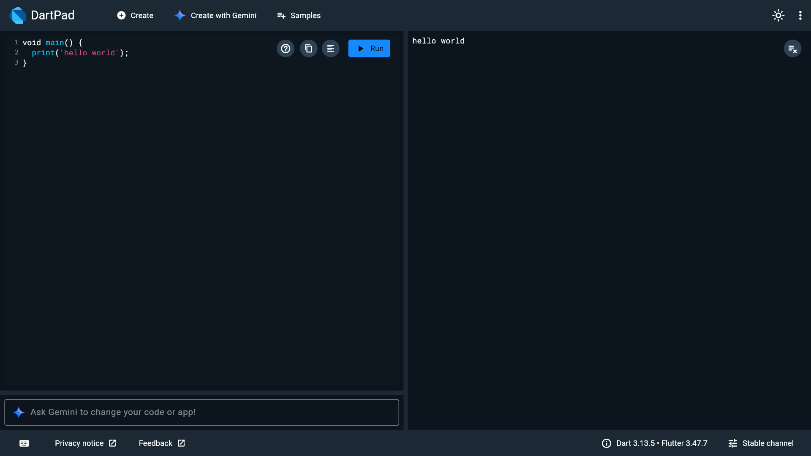
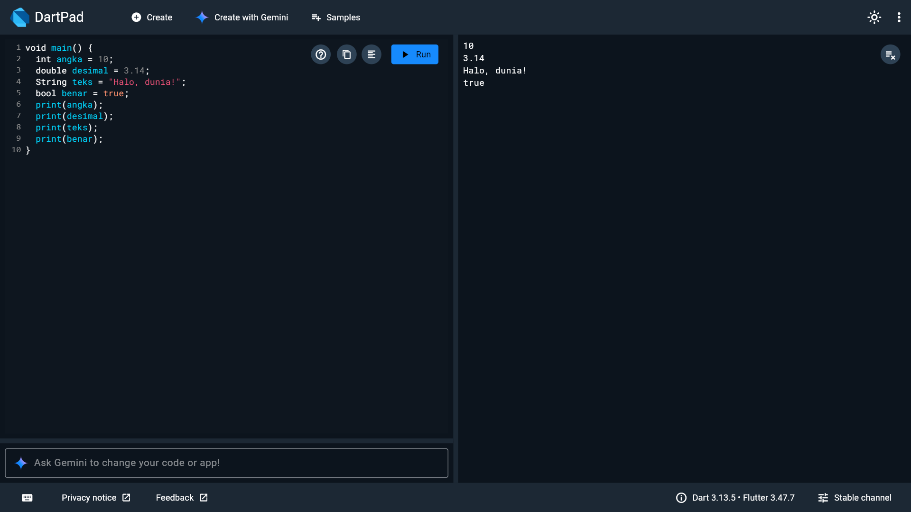
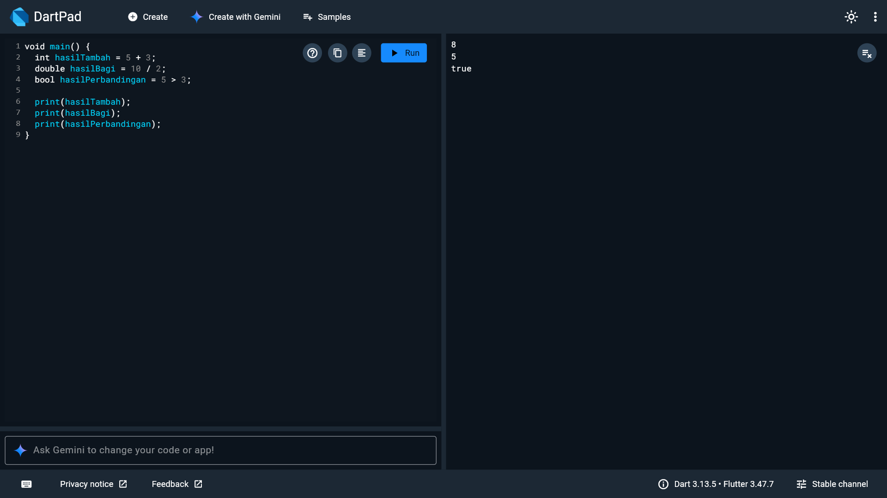
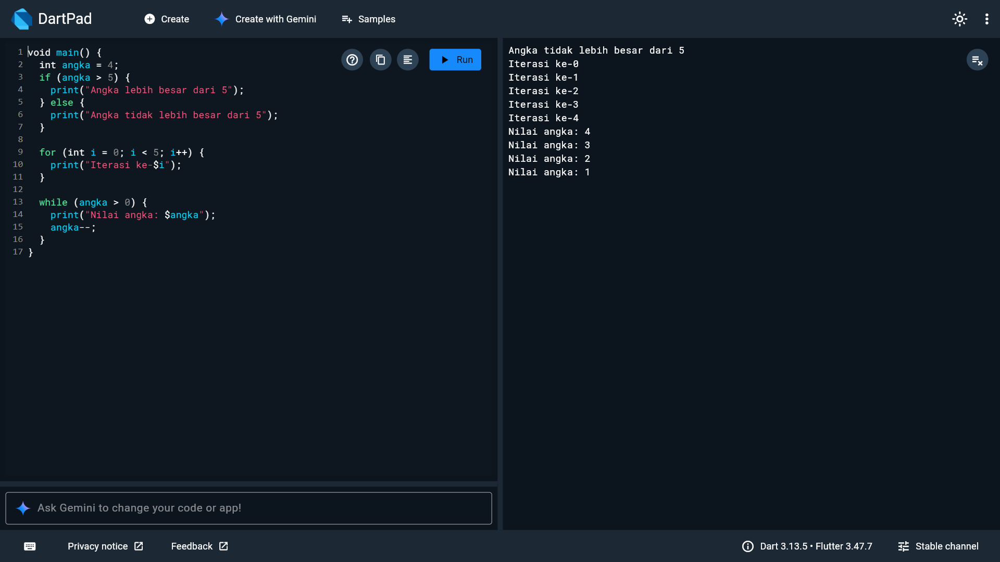
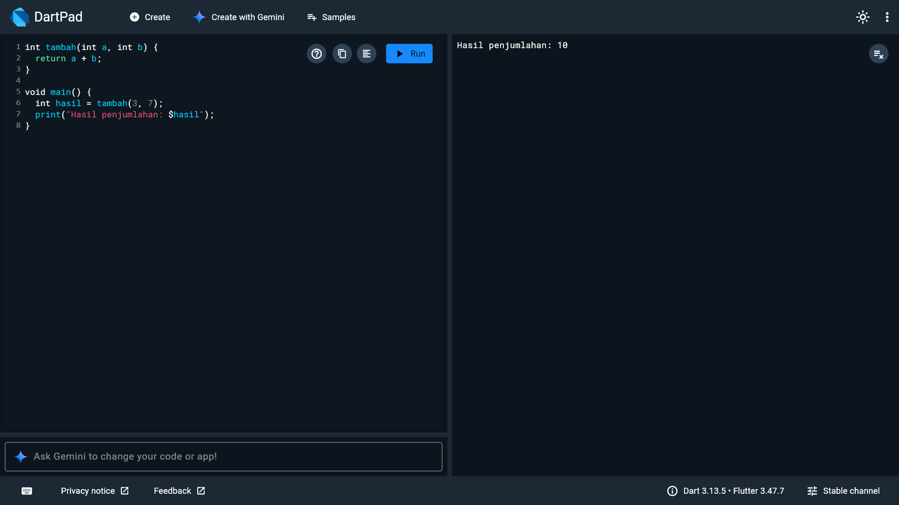
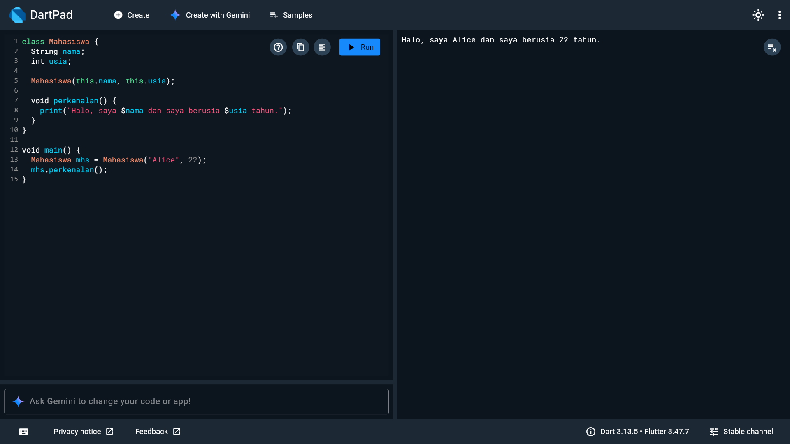
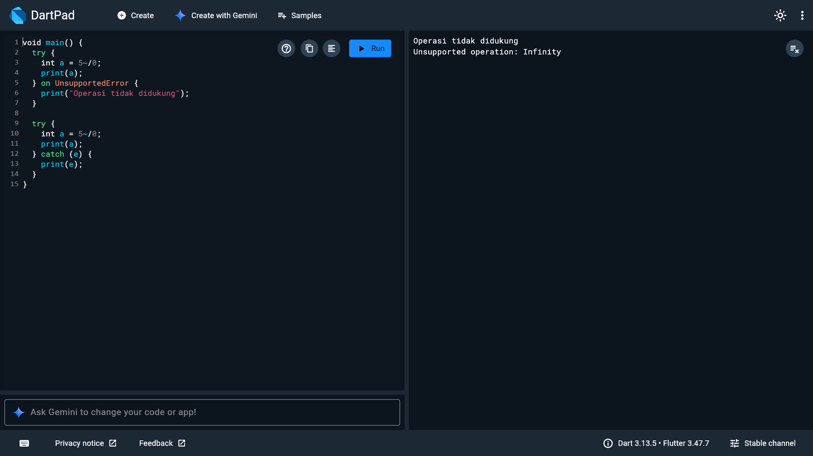
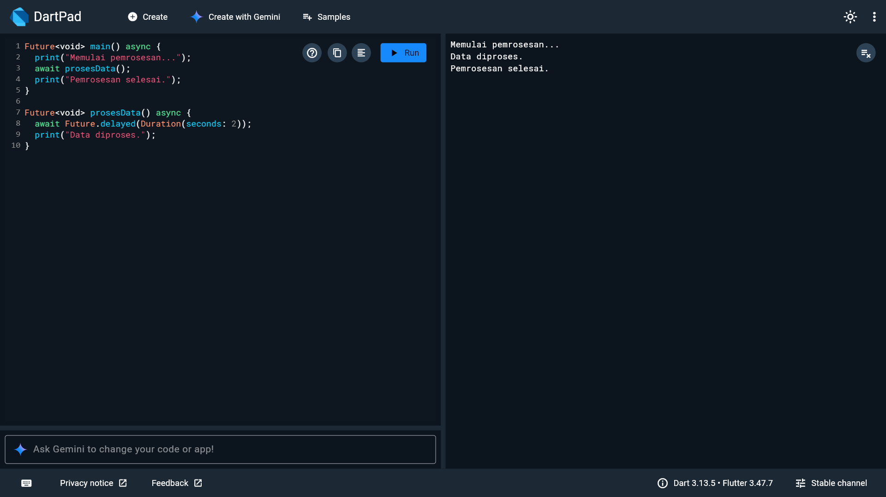

# Laporan Praktikum Pemrograman Mobile (Dart)

**Nama**        : Biladi Amna   
**NIM**         : H1D024074   
**Shift**       : Awal E / Akhir C    
**Praktikum**   : Pemrograman Mobile

---

## Tugas Pertemuan 7
**Tanggal**: Selasa, 20 Oktober 2026

  <table>
    <tr>
      <td align="center">
         
        <b>Hello</b>
      </td>
      <td align="center">
         
        <b>Tipe</b>
      </td>
      <td align="center">
         
        <b>Operasi</b>
      </td>
    </tr>
    <tr>
      <td align="center">
         
        <b>Kontrol</b>
      </td>
      <td align="center">
         
        <b>Fungsi</b>
      </td>
      <td align="center">
         
        <b>Kelas</b>
      </td>
    </tr>
    <tr>
      <td align="center">
         
        <b>Import</b>
      </td>
      <td align="center">
         
        <b>Eksepsi</b>
      </td>
      <td align="center">
         
        <b>Async</b>
      </td>
    </tr>
  </table>

**Kesimpulan Praktikum:**
Percobaan membuat program sederhana menggunakan bahasa Dart seperti Hello World dan operasi dasar pada pemrograman seperti Matematika, Kontrol, Fungsi, Eksepsi. Percobaan PBO menggunakan Dart dengan membuat Class dan modularitas dari Import. Kemudian percobaan agar kode dapat berjalan tanpa harus menunggu tugas sebelumnya selesai menggunakan Asinkronus.

---